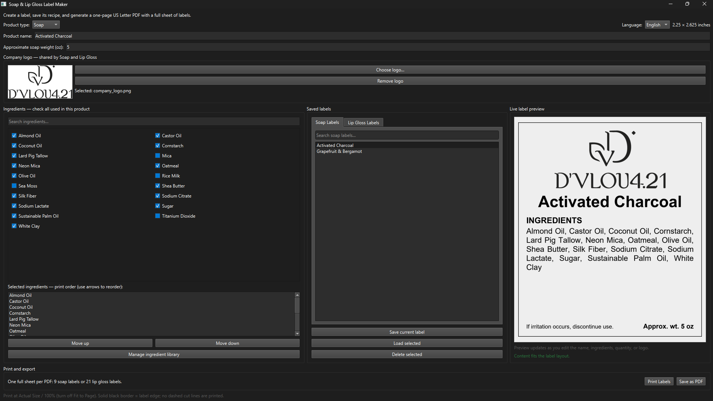

# Label Maker

A Python-based desktop application for creating, customizing, and managing product labels.

## Overview

This project explores the development of a desktop label-making application designed to simplify the process of creating and printing product labels. It provides an interface for managing product information, selecting ingredients or other label contents, previewing designs, and generating print-ready PDFs.

The application is a functional prototype that can be further developed and adapted for different labeling needs.

## Features

- **Label creation:** Create and customize product labels.
- **Content management:** Add and select label contents using a checkbox-based interface.
- **Search functionality:** Search ingredients, label contents, and saved labels.
- **Live previews:** Preview label designs before saving or printing.
- **Saved labels:** Save, organize, and search previously created labels.
- **PDF generation:** Generate print-ready PDFs with multiple labels arranged on US Letter paper.
- **Direct printing:** Print labels directly from the application.
- **Custom logos:** Use your own logo images on label designs.

## Technologies

- Python
- PySide6
- ReportLab

## Screenshot



## Getting Started

### Prerequisites

- Python 3.11 or a compatible Python version
- Required Python dependencies

### Installation

1. Clone or download this repository.
2. Open a terminal in the project directory.
3. Install the required dependencies:

   ```bash
   python -m pip install PySide6 reportlab
   ```

### Running the Application

Run the following command from the project directory:

```bash
python label_maker.py
```

## Privacy

The application is designed to work locally on the user's computer. Custom logos, saved labels, and application settings are intended for local use and should not be shared publicly without the user's consent.

This project does not intentionally collect or transmit personal data. Actual data handling depends on the application's implementation.

## Future Development

Potential improvements include a Windows installer, expanded customization options, additional label formats, and broader support for different product types.

## License

See the `LICENSE` file for the terms governing the use and distribution of this project.
